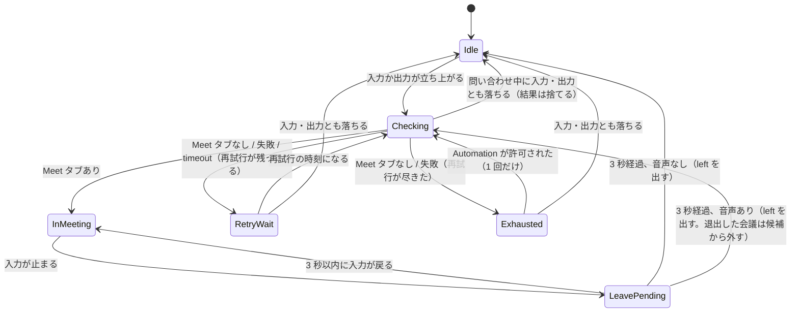

# 50. Google Meet 参加の自動検出と自動録音 詳細設計

対象読者: Kikimi 実装者（Claude Code 自身）。実装前に必ず読むこと。

参照元: `kikimi.md` 2 章（「カレンダー連携での会議自動検知・自動録音開始」を将来検討に挙げていた）,
10 章（録音の開始・一時停止・終了。Recording は1つだけ・破壊的操作の経路は2つだけ・Paused 放置は無害）,
`docs/design/09-raycast-integration.md`（`kikimi://record/quick`。本書の自動開始はこれを拡張した経路を通る）,
`docs/design/01-audio-capture.md`（CoreAudio のプロセスオブジェクト）,
`docs/design/26-settings-ui.md` §4.2（一般タブ）, `docs/design/46-control-socket.md`（busy 判定）。

**Chirami に参照実装は無い**。Chirami の現行ツリーには AppleScript / `NSAppleScript`、Automation 権限
（`NSAppleEventsUsageDescription`・`com.apple.security.automation.apple-events`。`Chirami.entitlements` は空の dict）、
Meet 検出、プロセス単位の `IsRunningInput` 監視のどれも無い。流用できるのは、書き起こし機能を削除する直前の
`1f4a2cb^:Chirami/Transcript/AudioProcessEnumerator.swift` に残る `readProcessState(selector: kAudioProcessPropertyIsRunningInput)`
の読み出しだけで、これは Kikimi の `AudioInputEnumerator.swift` にほぼ同じものがすでにある。
§2.2 の `ChromeTabInspector`、§2.3 の `MeetPresenceDetector`、§3 の `MeetAutoRecordCoordinator`、§4 の権限誘導 UI は
すべて参照実装なしの新規実装になる。見積もり（§11）はこの前提で立てている。

**実装状況**: 実装中（自動開始・自動一時停止・自動終了を1つの PR で入れる）。

## 0. 結論（要約）

**Chrome で Google Meet に参加したら録音を自動で始め、退出したら一時停止し、2 分戻らなければ会議を終了する**。

- 検出は2つの信号の組み合わせで行う
  - Chrome の音声: CoreAudio のプロセスごとの `IsRunningInput` / `IsRunningOutput` を 1 秒ごとに読む
  - Chrome のタブ: 音声の立ち上がりのとき（と、その後の有限回の再試行）だけ AppleScript でタブの URL を
    問い合わせ、`meet.google.com/xxx-xxxx-xxx` があるかを見る
- 参加 = Chrome の音声が立っている間に Meet のタブが見つかる。退出 = Chrome の入力が 3 秒以上止まる
- 自動開始は `WindowManager.quickRecord(overrides:)`（`kikimi://record/quick` の経路を引数つきに拡張したもの）を通す。
  録音中なら何もしない
- 自動で管理するのは**自動開始したセッションだけ**。手動で始めた録音には触らない。
  **ユーザーが手動で一時停止・再開・終了・削除したセッションは、その時点で管理対象から外す**
- 自動 resume と自動 end は、Coordinator 自身が一時停止したセッションにだけ行う
- 自動終了は既存の不変条件（`kikimi.md` 10 章「能動的な自動終了はしない」）の例外になる。
  §6 の条件付きで仕様を改訂する
- 既定は無効（オプトイン）。有効にすると初回に Chrome の Automation 許可を求める。
  許可ダイアログは設定画面の操作からだけ出し、監視の経路からは出さない

## 1. 背景と実測

会議のたびに録音ボタンを押す手間と、押し忘れ（冒頭の取りこぼし）をなくす。Meet はブラウザで動くので、
ネイティブアプリの起動検知では参加を判定できない。

2026-10-13 に確認用スクリプト（CoreAudio を毎秒読み、変化時に AppleScript でタブを問い合わせる）で
約 1.5 時間の実会議を測った。

| 観察 | 結果 | 設計への影響 |
|---|---|---|
| 音声フラグが立つプロセス | `com.google.Chrome.helper`（本体ではない） | bundle ID は前方一致 `com.google.Chrome` で見る |
| ミュート・ミュート解除 | `in=1` のまま変化なし | ミュートは退出と誤判定されない |
| 参加 | `out=1` が先、`in=1` が約 2 秒後 | 入力・出力どちらの立ち上がりでも判定に入る |
| 退出 | `in=0` → 約 2 秒後に `out=0` | 入力停止で退出と判定できる |
| PiP（タブ切り替え） | `tabs=1` の通常ウィンドウとして見える。音声フラグは変化なし | PiP は判定に影響しない |
| タブ列挙中のウィンドウ消滅 | `item 2 of every window ... 正しくないインデックス` で問い合わせ全体が失敗 | ウィンドウ単位でエラーを受け止める。問い合わせ失敗は「Meet なし」と区別する |
| 退出後のタブ | 「退出しました」画面が同じ URL のまま残る | URL だけでは退出を判定できない |
| 問い合わせ時間 | 0.7〜0.85 秒（タブ 26〜38 枚） | メインスレッドで呼ばない。立ち上がりと再試行のときだけ呼ぶ |

### 1.1 待機画面は参加と区別できない（実測）

2026-10-13 に、参加前の待機画面（「今すぐ参加」ボタンの画面）から参加までを2回測った。

| 場面 | 音声フラグ | タブの title | URL |
|---|---|---|---|
| 待機画面を開く | 約 2 秒で `out=1` → `in=1` | `Meet - <予定名>`（`↗ ` が前に付くことがある） | `/xxx-xxxx-xxx?authuser=...` |
| 「今すぐ参加」を押す | 変化なし | 変化なし | 変化なし |

待機画面はマイクのプレビューのために入力を開き、出力も開く。音声フラグ・title・URL のどれでも、
待機画面と参加後を区別できない。Meet の画面の中身（「退出」ボタンの有無）を読めば区別できるが、
次の理由で採らない。

- AppleScript から JavaScript を実行するには、Chrome の「Apple Events からの JavaScript を許可」を有効にする必要がある。
  この設定は全サイトに効くので、他のアプリから任意のページで JavaScript を動かせるようになる
- Chrome 拡張と Native Messaging の中継を作って配布するのは、本機能の規模に見合わない

そこで、**待機画面に入った時点で参加とみなす**。待機画面にいればたいていそのまま参加するので、
冒頭を取りこぼさないという目的に合う。余分に入るのは、参加までの間のユーザー自身のマイク音声だけになる。
参加せずにタブを閉じた場合は、退出として検出したあと、発言が無ければ §3.2 の手順 3 で破棄する。

## 2. 検出

### 2.1 Chrome の音声（`ChromeAudioActivityMonitor`）

- 1 秒ごとに `kAudioHardwarePropertyProcessObjectList` を列挙し、bundle ID が `com.google.Chrome` で
  始まるプロセスの `IsRunningInput` / `IsRunningOutput` を OR して1つのスナップショット
  `ChromeAudioActivity { input: Bool, output: Bool }` にする
- ポーリングにする理由: 既存の `OutputRouteMonitor` と `SystemAudioSource` の stall 検出もポーリングで、
  CoreAudio のプロパティリスナーはまだ使っていない。プロセスの出入りにも追従するリスナーを書くより、
  1 秒ごとに十数個のプロパティを読むほうが単純で、負荷も無視できる
- 読み出しは `AudioInputEnumerator.swift` の private ヘルパー（`readProcessBundleID` /
  `readProcessState(objectID:selector:)`）を internal にして共有する。`IsRunningInput` の読み出しを足す
- 機能が無効の間はタイマーを動かさない

### 2.2 Chrome のタブ（`ChromeTabInspector`）

- AppleScript で全ウィンドウの全タブについて `URL`・`title` と、各ウィンドウのアクティブタブを返す
- ウィンドウごとに `try` で囲み、1つのウィンドウの失敗で全体を落とさない（§1 の PiP 消滅）
- 結果は次の型で返す

| 結果 | 意味 |
|---|---|
| `.tabs([MeetTab])` | 成功。Meet の会議 URL のタブだけを返す（0 件もありうる） |
| `.chromeNotRunning` | Chrome が起動していない |
| `.failed(.notAuthorized)` | Automation が拒否されている（`AEDeterminePermissionToAutomateTarget` が `errAEEventNotPermitted`（-1743）、またはスクリプトが -1743） |
| `.failed(.notDetermined)` | Automation の許可がまだ決まっていない（-1744 `errAEEventWouldRequireUserConsent`）。監視の経路ではダイアログを出さずにここで返す |
| `.failed(.timeout)` | スクリプトの `with timeout` が切れた（-1712 `errAETimeout`） |
| `.failed(.other(code))` | それ以外の失敗 |

- `MeetTab { code: String, title: String, isActive: Bool }`。`code` は
  `^https://meet\.google\.com/(?:[A-Za-z_]+/)?([a-z]{3}-[a-z]{4}-[a-z]{3})(?:[/?#]|$)` の1番目のグループ。
  コードの前に1段パスが入る形（`/meet/abc-defg-hij`）がある。2026-10-21 にこの形の会議を会議と認識できず、録音しなかった
- ライブストリームの視聴ページ（`https://meet.google.com/stream/<UUID>`）も会議タブとして返し、`code` は
  `stream/<UUID>`（小文字）にする。待機画面の会議 URL が、配信の開始とともにこのページへ変わる（§2.3 の「ライブストリーム」）。
  title の `Meet ライブ ストリーム - ` も `Meet - ` と同じく剥がす

**実行の手順（§2.2.1）**

1 回の問い合わせ（`inspect(mode:)`）は次の順で進む。`mode` は `.monitoring`（監視の経路）か
`.interactive`（設定トグルの経路）。

1. **Chrome の起動を Swift 側で確かめる**: `NSRunningApplication.runningApplications(withBundleIdentifier: "com.google.Chrome")`
   が空なら `.chromeNotRunning` を返し、スクリプトを実行しない。`tell application "Google Chrome"` を含むスクリプトを
   Chrome の無い環境でコンパイルすると「Google Chrome はどこですか」ダイアログが出るため、スクリプト側の
   `is running` には頼らない
2. **Automation の許可を確かめる**: `AEDeterminePermissionToAutomateTarget(target, typeWildCard, typeWildCard, askUserIfNeeded)` を呼ぶ。
   `target` は bundle ID `com.google.Chrome` の `AEAddressDesc`
   - `.monitoring` では `askUserIfNeeded: false`。`noErr` 以外ならスクリプトを実行せず、上の表の `.failed` を返す。
     **監視の経路から許可ダイアログは出さない**。ダイアログで待たされている間にシリアルキューが詰まり、
     その間の `joined` 判定が失敗し続けるのを防ぐため
   - `.interactive` では `askUserIfNeeded: true`。ダイアログはここからだけ出る（§4）
3. **スクリプトを実行する**: 宛先は `tell application id "com.google.Chrome"` で指定する（名前ではなく bundle ID）。
   スクリプト全体を `with timeout of 5 seconds ... end timeout` で囲む。エラー -1712 は `.failed(.timeout)` に割り当てる
4. 結果を解析し、`MeetTab` の配列にして返す

- 実行は `NSAppleScript` を専用のシリアルキューで呼ぶ（0.8 秒かかるため。`NSAppleScript` は
  スレッドセーフでないので1本のキューに閉じる）。コンパイル済みの `NSAppleScript` は1つ持ち回す。
  `osascript` サブプロセスにしない理由は、Automation 許可の帰属先を Kikimi 自身にし、
  許可ダイアログに `NSAppleEventsUsageDescription` を出すため
- **タイムアウトの限界**: `NSAppleScript.executeAndReturnError` は同期 API で、外から中断できない。
  `with timeout` が効くのは Apple Event の応答待ちだけで、それ以外で詰まった場合はキューが塞がったままになる。
  外側に watchdog をかけても塞がったキューは解けないので、かけない。代わりに次の2点で影響を閉じ込める
  - 許可ダイアログという最大の詰まり要因を、手順 2 で監視の経路から締め出す
  - 問い合わせは同時に1件だけにする（§2.3 の「問い合わせの並行処理」）。前の問い合わせが返るまで次を積まないので、
    塞がっても溜まるのは 0 件で、返った時点で通常に戻る
- テストでは `protocol ChromeTabInspecting` のスタブに差し替える

### 2.3 参加・退出の判定（`MeetPresenceDetector`）

I/O を持たない純粋な状態機械。音声スナップショット・タブの問い合わせ結果・Automation 許可の状態を時刻つきで受け取り、
`joined(MeetTab)` / `left(code)` のイベントと、「問い合わせを始めよ（世代番号つき）」という要求を返す。
問い合わせの実行と時刻は呼び出し側（Coordinator 配下の `MeetPresenceMonitor`）が持つ。



- **問い合わせの契機**:
  - Idle のとき、`input` か `output` のどちらかが false → true に変わった時点
  - その後の再試行（下記）
  - 許可後の再問い合わせ（下記）
  - YouTube 再生中（`out=1`）に Meet へ参加しても、参加時に `in` が立ち上がるので拾える。それ以外の定期的な問い合わせはしない
- **再試行**: 問い合わせが「Meet タブなし」「`.failed`」「`.chromeNotRunning`」だったとき、音声（入力か出力）が
  立ち続けている限り、立ち上がりから **5 秒・15 秒・30 秒後**にもう一度問い合わせる（最大 3 回）。
  タブがまだ会議 URL に遷移していない・ウィンドウ消滅で1回失敗した、といった一時的な失敗で、
  音声が鳴り続ける限り次の立ち上がりが来ずに会議全体を取りこぼすのを防ぐ。3 回とも外れたら `Exhausted` に入り、
  以後は音声が鳴っている間 30 秒に1回だけ問い合わせる（YouTube を何時間も流していても 1 時間に 120 回・計 1〜2 分に収まる）。
  当初は音声が落ちるまで一切問い合わせなかったが、URL を認識できなかった会議を最後まで取りこぼした（2026-10-21）ため改めた。
  ただし `.failed(.notAuthorized)` / `.failed(.notDetermined)` は再試行しても結果が変わらないので、即 `Exhausted` に入る
- **許可後の再問い合わせ**: `Exhausted` にいる間、`MeetPresenceMonitor` は 1 秒ごとのスナップショットのついでに
  `AEDeterminePermissionToAutomateTarget(askUserIfNeeded: false)` の結果を渡す（呼び出しは軽く、ダイアログも出ない。
  前回が `noErr` 以外のときだけ呼ぶ）。それが `noErr` に変わったら1回だけ `Checking` に入る。
  設定トグルで出した許可ダイアログに会議中に「許可」を押した場合でも、その会議を拾える
- **問い合わせの並行処理**:
  - (1) 実行中の問い合わせは常に 0 件か 1 件。状態機械は `Checking` の間、新しい問い合わせを要求しない。
    `Checking` 中に届いたスナップショットは「最新の音声状態」として覚えるだけ
  - (2) 問い合わせの要求には単調増加の世代番号を付け、結果はその番号つきで状態機械に戻す。
    状態機械が持つ現在の世代番号と一致しない結果は捨てる
  - (3) `Checking` 中に入力・出力とも false になったら、世代番号を進めて `Idle` に戻る（実行中の結果は届いても捨てる）。
    入力だけ落ちて出力が残っている場合は `Checking` のまま待つ
  - (4) 結果を受け取った時点で `Checking` を抜けるとき、`InMeeting` の「入力を観測したか」は最新のスナップショットから決める
  - 実行中の問い合わせが返らないまま新しい立ち上がりが来ても、次の問い合わせは前のものが返るまで積まない
    （§2.2.1 の「タイムアウトの限界」）。`MeetPresenceMonitor` は実行中フラグを、`NSAppleScript` の呼び出しが
    実際に返ったときにだけ下ろす
- **入力を一度も持たない参加**: マイク許可を出していない場合など、参加中に `in=1` が一度も来ないことがある。
  このときは退出の判定に `output` を使う（`InMeeting` に入ったあと `input` を一度でも観測したかを覚えておく）
- **デバウンス 3 秒**: マイクデバイスの切り替えで入力が一瞬落ちても退出にしない。実測では退出時に
  入力が落ちてから戻ることはなかった
- **ライブストリーム**: 視聴者として参加するライブストリームでは、待機画面（`/meet/<code>`）が配信の開始とともに
  視聴ページ（`/stream/<UUID>`）に変わる。視聴ページはマイクを閉じ、出力だけを鳴らし続ける。2026-10-19 と 2026-10-26 に、
  次の流れで会議全体を録音し損ねた
  - 待機画面で参加と判定し、視聴ページに移った 4 秒後に入力の停止で `left` を出す。待機画面のセッションは発言 0 件で破棄される
  - `Idle` に戻ったあとは出力が鳴り続けるので立ち上がりが来ず、問い合わせない（10-26 は 18 分間）
  - 問い合わせても、視聴ページの URL を会議と認識しなかった

  対処は3つ。
  - (1) §2.2 で視聴ページを会議タブとして返す
  - (2) `left` を出した時点で入力か出力がまだ立っていれば、`Idle` に戻さず、その時刻を立ち上がりとみなして
    すぐ `Checking` に入る（再試行の手順もそのまま使う）。このとき退出した会議コードのタブは候補から外す。
    退出後も「退出しました」画面が同じ URL で残るので、外さないと即座に再参加と判定してしまう。
    除外は、入力が再び立ち上がったとき（同じ会議への再参加）と、会議に入ったときに解く
  - (3) 視聴ページ（`code` が `stream/` で始まる）では `input` を観測しても「入力を観測した」にしない。
    退出は出力の停止で判定する。視聴中に次の会議の待機画面を開いた場合は、下の「会議の切り替え」で拾う

  待機画面と視聴ページは別のセッションになる。待機画面のセッションは空なので発言 0 件で破棄され、
  取りこぼしは視聴ページに移ってからの約 4 秒になる
- **会議コードの選び方**（Meet タブが複数あるとき）: (1) アクティブなタブ、(2) 直前に退出した会議コード以外、
  (3) 先頭、の順。前の会議の「退出しました」画面が残っているケース（§1）への対処
- **会議の切り替え**: 会議 A の途中で会議 B の待機画面が開き、そのまま B に移ると、B が先にマイクとスピーカーを開くので
  Chrome 全体の音声は一度も止まらない。音声だけでは A の退出を検出できず、A と B が1つのセッションにつながる
  （2026-10-14 に実際に起きた。9:30 に B のウィンドウが自動で開き、9:31 に B へ移った）。そこで `InMeeting` の間は
  30 秒ごとにタブを問い合わせる。最前面の Chrome ウィンドウのアクティブタブが、
  今の会議と別の会議コードの Meet なら、`left(A)` と `joined(B)` を続けて出す。Coordinator はこれを通常の退出と参加として扱う
  （A は一時停止 → 猶予後に終了、B は新しいセッション）
  - 「最前面」は、Chrome の `windows`（前から順）のうち、アクティブタブが Web ページ（`http` で始まる URL）である最初のウィンドウ。
    Meet の PiP（小窓）は常に最前面にあり、アクティブタブが Web ページではない。最初は `window 1` をそのまま使っていたため、
    A の PiP が出ている間は B を前面にしても切り替わらず、2026-10-20 に B の最初の 5 分が A のセッションに入った
  - 背景のウィンドウや非アクティブなタブに別の会議があるだけでは切り替えない
  - 問い合わせは同時に1件だけ。失敗したら次の間隔でやり直す
  - 弱点: 会議中に別の会議の Meet を開いて前面にすると、参加しなくても切り替わる。新しいセッションの `取り消す` と、
    前のセッションの `終了しない` で戻せる
- **起動時**: 監視開始時のスナップショットは「前回値なし」から比較するので、すでに参加中なら立ち上がり扱いになり
  `joined` を出す（実測でもそう動いた）。アプリを会議中に再起動しても録音が始まる

## 3. 自動録音の振る舞い（`MeetAutoRecordCoordinator`）

`@MainActor` のシングルトン。`MeetPresenceDetector` のイベントを受けて、セッションを操作する。
録音の状態遷移は既存の `MeetingWorkspaceViewModel` のメソッドを通す（新しい遷移を書かない）。
例外は §3.5 の「中断して破棄」で、これは VM に新しいメソッドを足す。

### 3.0 管理対象の持ち方

管理対象は sessionId をキーにした辞書で持つ。

```swift
struct ManagedSession {
    let sessionId: String
    let meetingCode: String
    var phase: Phase                 // .recording / .pausedAwaitingEnd(deadline: Date) / .pausedNoAutoEnd
    var pausedByCoordinator: Bool    // Coordinator 自身が pause したときだけ true
    var endTimer: Task<Void, Never>? // .pausedAwaitingEnd のときだけ非 nil
    var startBannerDeadline: Date?   // 「録音を始めました / 取り消す」バナーを消す時刻
}

var managed: [String: ManagedSession]   // 自動録音したセッションのうち、まだ手を離していないもの
var currentSessionId: String?           // そのうち、いまの Meet の参加・退出に紐づく1つ
```

- `currentSessionId` は「次の `left` / 同じコードの `joined` で操作する相手」で、同時に1つ
- `managed` には、別の Meet に移ったあとも終了タイマーが動いている前のセッションが残る。タイマー満了時の
  §3.2-3 は `managed` のエントリに対して行う。これで「管理対象は1つ」と「前のセッションのタイマーは動かし続ける」が両立する
- エントリは §3.3 の条件で辞書から消す。消すときはタイマーを取り消し、バナーを消す

### 3.0.1 VM の取り出し方

pause / resume / endMeeting は `WindowManager.workspaceControllers[sessionId]` が持つ VM のメソッドだが、Paused の
ウィンドウはユーザーが閉じられる（`windowShouldClose` が止めるのは Recording 中だけ）。閉じると controller と VM は
破棄される。Coordinator は VM を直接持たず、次のプロトコル越しに取り出す。

```swift
@MainActor
protocol AutoRecordWorkspaceProviding {
    /// Returns the open view model, or opens the Session Window (`WindowManager.openWorkspace`) and returns its view model.
    /// `presentation` applies only when the window has to be (re)opened (§3.6).
    func workspace(for sessionId: String, presentation: WorkspacePresentation) async throws -> AutoRecordWorkspace
    func quickRecord(overrides: DraftMetaOverrides, presentation: WorkspacePresentation) async throws -> AutoRecordWorkspace
    var recordingSessionId: String? { get }
}
```

- 本番の実装は `WindowManager` のアダプタで、`workspaceControllers` にあればそれを、無ければ `openWorkspace(sessionId:)`
  で開き直して返す（設計判断 (b)）。猶予の満了時にウィンドウが閉じていても、開き直して `endMeeting()` する。
  開き直したウィンドウは Ended の画面になり、自動終了したことがユーザーに見える
- (a)「閉じたら管理対象から外す」を採らない理由: 閉じたまま Paused で残ると、自動終了で解きたかった
  「`on_session_end` が走らないセッションが溜まる」がそのまま起きる。ウィンドウを閉じるのは会議を終える意思に近い
- (c)「`on_session_end` を VM の外へ切り出す」を採らない理由: `endMeeting()` の中身（capture 停止・final pass・
  Wiki export・Watcher）を二重に持つことになり、本機能の範囲を超える
- `openWorkspace` が throw した（セッションフォルダが消えている等）ときは、エントリを `managed` から外して `error` ログを出す
- `AutoRecordWorkspace` は VM のうち Coordinator が使う部分（`sessionId`、`recordingButtonState` の読み出しと
  `recordingButtonStatePublisher` による購読、`hasConfirmedTranscript`、`onBannerAction`、
  `pauseRecording` / `resumeRecording` / `endMeeting` / `discardAutoRecordedSession`、`showBanner` / `removeBanners(withId:)`）
  だけを出すプロトコル。§10 のフェイクはこの2つのプロトコルの境界で差し替える。
  Coordinator は VM を弱参照でしか覚えない（バナーの消去と購読にだけ使う）。操作の直前には `provider.workspace(for:)` で取り直す
- 時刻とタイマーは `AutoRecordClock`（`now` と `sleep(until:)`）で注入する。本番は `Task.sleep`、テストは手動で進める時計
- `joined` / `left` は Coordinator 内のキューで1件ずつ順に処理する（`quickRecord` の await 中に `left` が届いても順序が入れ替わらない）。
  終了タイマーの満了は別 Task で動き、その時点でエントリを先に外してから VM を取り出す
- §3.1-2 の再参加でウィンドウを取り出せなかったときは、エントリを外したうえで §3.1-3 の新規開始に進む

### 3.0.2 操作の結果の判定

VM の `pauseRecording()` / `resumeRecording()` / `endMeeting()` / `startRecording()` は Void を返し、失敗すると
`.pausing` / `.ending` などに留まるか、元の状態に戻る。Coordinator は `await` が返った直後の `recordingButtonState` で成否を決める。

| 操作 | 成功とみなす状態 | 失敗したとき |
|---|---|---|
| 開始（`quickRecord`） | `.recording` | §3.1-3 の規則 |
| pause | `.paused` | エントリを外す。`error` ログ。VM は `.pausing` のまま残り、ユーザーがボタンで再試行できる |
| resume | `.recording` | `phase = .pausedNoAutoEnd` にして手を離す（エントリは外す）。`warning` ログ |
| end | `.ended` | エントリを外す。`error` ログ。VM は `.ending` のまま残る |

### 3.0.3 自分の操作とユーザーの操作の区別

- Coordinator は VM の `$recordingButtonState`（`@Published`）を、`managed` にあるセッションの VM について購読する
- VM を呼ぶ直前に `operationInFlight[sessionId] = .pause / .resume / .end / .discard` を立て、`await` が返って
  §3.0.2 の判定を終えたら下ろす
- 購読で見た遷移のうち、`operationInFlight[sessionId]` が nil のときに起きた次の遷移はユーザーの操作とみなす
  - `.recording` → `.pausing`: 手動の一時停止
  - `.paused` → `.resuming`: 手動の再開
  - `.recording` / `.paused` → `.ending`: 手動の会議終了
- 一時停止・再開・終了はすべて VM の `@MainActor` メソッドで、最初の同期部分で `recordingButtonState` を書き換える。
  Coordinator も `@MainActor` なので、フラグを立ててから呼べば、その書き換えは必ずフラグが立っている間に購読へ届く
- 削除は購読では見えないので、`WindowManager.handleSessionDeleted(sessionId:)` から
  `MeetAutoRecordCoordinator.shared.sessionDidDisappear(sessionId)` を呼ぶ
- ウィンドウが閉じると購読は切れる。閉じている間にユーザーができる操作は Session List からの削除だけで、
  上の `sessionDidDisappear` で拾える。ウィンドウが開き直されたら（`openWorkspace` の末尾から
  `workspaceDidOpen(sessionId:viewModel:)` を呼ぶ）、`managed` にあれば購読し直す

### 3.1 参加したとき

1. `recordingSessionId` が非 nil（録音中のセッションがある）なら何もしない。
   手動の録音を優先する（`kikimi://record/quick` と同じ規則）。`info` ログ
2. `managed` に同じ会議コードのエントリがあり、`phase == .pausedAwaitingEnd` かつ `pausedByCoordinator == true` なら
   （§3.2 の猶予中に戻ってきた）、終了タイマーを取り消して `resumeRecording()` する。成功したら
   `phase = .recording`・`pausedByCoordinator = false`・`currentSessionId` をそのセッションにする。
   `pausedByCoordinator == false` のエントリは自動 resume しない（そもそも §3.3 で外れているので辞書に無い）
3. それ以外は `quickRecord(overrides:)` で Draft を作って録音を始める
   - `DraftMetaOverrides` は Draft の作成時に `SessionMeta` へ入れる値（§9）
     - `title`: Meet タブのタイトルから先頭の `↗ ` と `Meet - ` を除いたもの。タブのタイトルが会議コードだけなら nil（空のまま）
     - `titleAutoNamedOnce`: タイトルを入れたときは `true`。`titleAutoGenerated` は `true` のまま
     - `autoRecord`: `{ source: google_meet, meeting_code: "xxx-xxxx-xxx" }`
   - **タイトルの扱い**: 新規 Draft の既定（`titleAutoGenerated = true` / `titleAutoNamedOnce = false`）のままだと、
     `SummaryUpdater.applyAutomaticTitle` が録音中の最初のサマリ更新で Meet のタイトルを上書きする。
     Meet のタイトルはカレンダーの予定名であることが多く、LLM が作る名前より会議を見分けやすいので残す。
     そのため `titleAutoNamedOnce = true` で作る。以後の自動タイトルは `titleProposal`（提案バッジ）として出るだけで、
     会議終了時の `applyFinalTitleProposal` も提案を出すだけなので、どちらも上書きしない。
     タイトルを入れなかった（会議コードだけの）ときは既定どおり `titleAutoNamedOnce = false` で、最初のサマリ更新で名前が付く
   - 作成後に `updateMeta` で入れない理由: VM の hydrate や `startRecording()` の meta 書き込みと競合するため。
     `SessionStore.createDraftSession` が `SessionMeta` を作る時点で入れる
   - **開始の成否**: `quickRecord` は `startRecording()` を await したあと controller を返すが、`startRecording()` は throw しない
     （入力の解決に失敗すると状態を変えずに戻り、`beginRecording` 以降の失敗はロールバックして `.startRecording` に戻る。
     どちらも VM のバナーにだけ出る）。Coordinator は返ってきた VM の `recordingButtonState` が `.recording` のときだけ
     管理対象にする。それ以外なら管理対象にせず、`error` ログを出す。Draft は消さずに残す（VM が出す失敗バナーを
     ユーザーが見て、手動で録音を始めるか削除できるように）
   - ウィンドウにバナー「Google Meet への参加を検出して録音を始めました」と `取り消す` ボタンを出す（§3.4 の情報バナー）
4. `managed[sessionId]` を作り（`phase = .recording`・`pausedByCoordinator = false`）、`currentSessionId` にする。
   それまでの `currentSessionId`（別の会議のセッション）が `managed` に残っていれば、そのエントリは消さない。
   タイマーはそのまま動く（§3.0）

`取り消す` は §3.5 の「中断して破棄」を行う。誤検出で作られた空に近いセッションを片付けるためのもので、
バナーは 60 秒で消える。消えたあとは `取り消す` は使えないが、セッションは引き続き管理対象として退出・自動終了の対象になる。

### 3.2 退出したとき

`currentSessionId` のエントリに対してだけ動く（`left(code)` の会議コードがエントリと一致するときだけ）。
手動で始めた録音・管理対象から外れたセッションには何もしない。

1. セッションが Recording なら `pauseRecording()` し、成功したら `pausedByCoordinator = true` にする。
   Recording でなければ何もしない（ユーザーが手動で Paused にしていれば §3.3 でエントリはすでに外れている）
2. `end_grace_seconds > 0` なら `phase = .pausedAwaitingEnd(deadline)` にして終了タイマーを動かし、
   バナー「Meet からの退出を検出して一時停止しました。HH:mm に会議を終了します」（残り時間ではなく時刻で出す。再描画しなくても正しいため）と `終了しない` ボタンを出す。
   `end_grace_seconds == 0` なら `phase = .pausedNoAutoEnd` にしてエントリを外す（自動終了しない）
3. タイマーが満了したら、§3.0.1 で VM を取り出し、`pausedByCoordinator == true` かつ
   `recordingButtonState` が `.paused` / `.pausedDisabledOtherRecording` のときだけ次のどちらかを行う。
   それ以外の状態なら何もしない。どの場合もエントリを外す
   - 確定した書き起こしの行が 1 件以上ある → `endMeeting()`（`on_session_end` が走る）
   - 1 件も無い → `discardAutoRecordedSession()`（§3.5）で破棄する。待機画面に入っただけで参加しなかった、
     または参加しても誰も話さなかったセッションに、Wiki export と LLM 呼び出しを走らせないため。
     `info` ログに破棄した理由を残す
4. `終了しない` を押すと、タイマーを取り消してエントリを外す。以後は手動のセッションと同じで、Paused のまま残る

`currentSessionId` は退出後もそのセッションを指したままにし、同じ会議コードの `joined` で §3.1-2 に入れるようにする。
別のコードの `joined` で新しいセッションに切り替わる。

### 3.3 管理対象から外れる条件

次のどれかが起きたら、そのセッションのエントリを `managed` から外す（タイマー取り消し・バナー削除・購読解除）。
`currentSessionId` がそのセッションなら nil にする。

- ユーザーが手動で一時停止した（§3.0.3 で `.recording` → `.pausing` を検出）。
  **オフレコのために止めた録音を、回線断などの退出 → 再参加で勝手に再開しないため**
- ユーザーが手動で再開した（Paused → Recording）。会議の外でも録音を続けたい意思とみなす
- ユーザーが手動で `⏹ 会議終了` した
- セッションが削除された（`取り消す`、または Session List からの削除）
- 終了タイマー中に `終了しない` を押した
- §3.0.2 の失敗、§3.2-3 の満了、`end_grace_seconds == 0` での退出

別の Meet に参加しても、前のセッションのエントリは外さない（§3.1-4）。

### 3.4 バナーの基盤

今の `WorkspaceBanner` / `WorkspaceBannerRow`（`Kikimi/Views/MeetingWorkspace/MeetingWorkspaceView.swift` 418 行目以降）は
警告アイコンと × ボタンだけの単一の見た目で、アクションボタン・自動で消える仕組み・情報用の見た目が無い。
また `WindowManager.swift` 535 行目の `recordingHasWarning: !viewModel.banners.isEmpty` があるため、
情報バナーを足すだけでメニューバーが警告アイコンに変わる。次のとおり拡張する。

- `WorkspaceBanner` に `severity: BannerSeverity`（`.warning` / `.info`）を持たせる計算プロパティを足す。既存の case はすべて `.warning`
- 新しい case
  - `.autoRecordStarted(sessionId:)` — `.info`。アクション `取り消す`
  - `.autoRecordEndScheduled(deadline: Date)` — `.info`。アクション `終了しない`。残り時間は `deadline` から表示する
- `WorkspaceBanner` に `actions: [BannerAction]`（ラベルとアクション ID）を返す計算プロパティを足し、
  `WorkspaceBannerRow` はそれをボタンとして並べる。押されたら VM の `onBannerAction: ((WorkspaceBanner, BannerActionID) -> Void)?`
  を呼ぶ。Coordinator は VM を購読するときにこのコールバックを設定する
- `WorkspaceBannerRow` は `severity == .info` のとき情報アイコンと控えめな色で描く
- 自動で消す仕組みは VM に持たせず、Coordinator が `startBannerDeadline` を見て Task で消す
  （ウィンドウが閉じていればバナーも VM ごと消えているので何もしない）
- `recordingHasWarning` は `viewModel.banners.contains { $0.severity == .warning }` に変える

### 3.5 中断して破棄（`取り消す`）

`SessionStore.deleteSession` は `recordingSessionId` と一致すると `.cannotDeleteActiveRecording` を投げるので、
Recording 中のセッションはまず止める必要がある。ただし既存の止め方はどちらも使えない。

- `endMeeting()`: `on_session_end`（Wiki export・最終タイトル生成・Watcher の LLM 呼び出し）が誤検出のセッションに走る
- `pauseRecording()`: サマリの `updateNow(reason: .pauseFlush)`（LLM 呼び出し）と `refinementQueue.flush()` が走り、
  `refinementQueue` はその後も動き続ける。削除したフォルダに後から書き込みが起きる恐れがあり、課金も無駄になる

そこで VM に `discardAutoRecordedSession()` を足す。手順は次のとおり。

1. `recordingButtonState` が `.recording` / `.paused` / `.pausedDisabledOtherRecording` でなければ何もしない（最後の状態は §3.2-3 の満了時に起こりうる）。`.discarding` にする（新しい状態。ボタンは無効）
2. `stopElapsedTimer()`、`stopCaptureAndPipelineIfNeeded(diarizationEndReason: .paused)` で capture と STT を止める
3. サマリは flush せずに `stopSummaryUpdater()` で捨てる
4. `refinementQueue?.cancelAndWait()`（新規）: 未送信のバッチを捨て、送信中の呼び出しが返るのを待ち、その結果は書き込まない。
   その後 `refinementQueue` を nil にする
5. `watcherRunner.shutdown()` で interval Watcher も含めて止める
6. Recording だった場合は `SessionStore.abandonRecording(sessionId)`（新規）で `recordingSessionId` を nil に戻す。
   `pauseRecording(_:)` と違って meta は書き換えない（すぐ消すため）
7. `finishStoppingCapture()`
8. `SessionStore.shared.deleteSession(sessionId)`
9. `WindowManager.shared.handleSessionDeleted(sessionId:)`（ウィンドウを閉じ、`AppState` から消し、
   §3.0.3 の `sessionDidDisappear` を呼ぶ）

- `SessionListViewModel.delete` の後処理のうち、toast は不要（ユーザーがバナーで押した操作なので）。一覧の再読み込みと
  `incompleteSessionsBanner` からの削除は必要なので、`handleSessionDeleted` の中で `sessionListController` があれば
  その VM の `refresh()` を呼ぶ形に寄せる（`SessionListViewModel.delete` も同じ経路を通るので二重にはならない。
  `delete` 側の `refresh()` 呼び出しは消す）
- 手順 8 が失敗したら `error` ログを出し、セッションは Paused として残す（`pauseRecording(_:)` 相当の meta 更新を行ってから
  `.paused` にする）。`取り消す` のバナーは消し、失敗のバナー（`.warning`）を出す

### 3.6 ウィンドウを出さない録音と macOS 通知

自動録音は、既定ではウィンドウを一度も表に出さずに動かす。ユーザーは会議に集中していて、Kikimi のウィンドウが
Meet の上に出ると邪魔になる。

- **開始**: `quickRecord(overrides:presentation:)` に `.stowed` を渡す。`WindowManager.openWorkspace(sessionId:presentation:)` は
  `.stowed` のときウィンドウを表示せずにコントローラと VM だけを作り、`stowedSessionIds` に入れる
  （design 18 §3.2 の「しまう」と同じ状態。メニューバーの「〜 を表示」から開ける）
- **終了・再開**: §3.0.1 でウィンドウが閉じられていて開き直すときも、`.stowed` で開き直す。
  design 18 の R6' のとおり、しまってあるウィンドウは会議終了で自動的には出てこない
- `auto_record.google_meet.window: shown` のときは従来どおりウィンドウを表示する（§4）
- ユーザーが自分で表示したウィンドウを Coordinator がしまい直すことはしない
- 自動終了したセッションのウィンドウがまだしまってあれば閉じる（`closeWorkspaceWindowIfStowed`）。閉じないと、会議ごとに
  Ended の VM とメニューバーの「〜 を表示」が溜まり続ける。サマリは「会議を終了しました」の通知か Session List から開く
- 設定トグルを通らずにオンになった場合（`config.yaml` を直接書いた、通知の追加前からオンだった）に備え、監視を始めるとき
  通知の許可が未決定なら一度だけ求める

ウィンドウ内のバナーはしまってあると見えないので、同じ内容を macOS 通知（`UNUserNotificationCenter`）でも出す。
通知の送信は `protocol AutoRecordNotifying` の裏に閉じ、テストではフェイクに差し替える。

| 契機 | 通知の本文 | アクション | 消すタイミング |
|---|---|---|---|
| 自動開始（§3.1） | 「Google Meet の録音を始めました」＋タイトル（あれば） | `取り消す` | 60 秒後（バナーと同じ）・エントリが外れたとき |
| 退出を検出（§3.2） | 「Meet から退出しました。HH:mm に会議を終了します」 | `終了しない` | 満了・再参加・エントリが外れたとき |
| 自動終了（§3.2-3） | 「会議を終了しました」 | なし（本文クリックでウィンドウを表示） | 残す |
| 発言 0 件で破棄（§3.2-3） | 「発言がなかったため録音を破棄しました」 | なし | 残す |
| 自動開始に失敗（録音が始まらなかった） | 「Google Meet の自動録音を開始できませんでした…」。あわせてウィンドウを表示する | なし | 残す |
| 猶予 0 で退出（§3.2-2） | 「Meet から退出したため録音を一時停止しました」 | なし | 残す |

- `AutoRecordNotifying` は `post(_:)`・`remove(_:sessionId:)`・`requestAuthorization()`・`currentAuthorization()` を持つ。
  本番の `AutoRecordNotifier.shared` は `.app` バンドルの外（`swift test`）では何もしない。delegate とカテゴリは起動時の `activate()` で設定する
- 既に開いているコントローラに `.stowed` で `openWorkspace` を呼んでも表示は変えない（表示中のウィンドウをしまわない）
- 通知の識別子はセッション ID と種類から作り（`autoRecord.<kind>.<sessionId>`）、同じセッションの古い通知は差し替える
- アクションと本文クリックは `UNUserNotificationCenterDelegate` で受け、`MeetAutoRecordCoordinator` の
  バナーのボタンと同じ処理（§3.4 の `BannerActionID`）に流す。本文クリックは `showWorkspaceWindow(sessionId:)`
  （ウィンドウが閉じていれば `openWorkspace(sessionId:presentation: .shown)` で開き直す。既存なら内部で `showWorkspaceWindow` に流れる）
- アプリが前面にいても出す（`willPresent` で `.banner` と `.list` を返す）。音は鳴らさない
- 通知の許可は、設定でトグルをオンにしたとき Automation の許可と続けて求める（§4）。拒否されても録音は動く。
  そのときは通知を出さず、メニューバーの録音中表示とウィンドウ内のバナーだけになる

## 4. 設定

`config.yaml` に `auto_record` セクションを足す（`AudioConfig` と同じ形の `AutoRecordConfig`）。

```yaml
auto_record:
  google_meet:
    enabled: false          # 既定は無効（オプトイン）
    end_grace_seconds: 120  # 退出から会議終了までの猶予。0 なら自動終了せず Paused のまま残す
    window: stowed          # stowed: ウィンドウを出さずに録音する（§3.6）/ shown: 開始時にウィンドウを表示する
```

- `window` が `stowed` / `shown` 以外のとき（綴り間違い）は警告せず既定の `stowed` で読む（設定全体を壊さない）
- 設定画面の一般タブに「会議の自動録音」セクションを足し、`Google Meet への参加で録音を始める` のトグルと
  猶予の選択（しない / 1 分 / 2 分 / 5 分）と、「録音中のウィンドウ」の選択（隠す / 表示する）を置く
- 通知の許可（§3.6）は、Automation の許可を求めた直後に `requestAuthorization(options: [.alert])` で求める。
  拒否されていたら、トグルの下に「通知がオフのため、自動録音の開始・終了はメニューバーでしか分かりません」と出す
- トグルを有効にした時点で `ChromeTabInspector.inspect(mode: .interactive)` を一度呼び、Automation の許可ダイアログを出す。
  **許可ダイアログを出すのはこの経路だけ**（§2.2.1）。Chrome が起動していなければダイアログは出せないので、
  トグルの下に「Chrome を起動したあと、もう一度オンにすると許可を求めます」と出し、「許可を確認」ボタンで同じ呼び出しをやり直せるようにする
- 拒否された（`.notAuthorized`）ら、トグルの下に「システム設定 > プライバシーとセキュリティ > オートメーション
  で Kikimi に Google Chrome の制御を許可してください」と、その画面を開くボタンを出す。
  監視は動かし続ける。許可されれば §2.3 の「許可後の再問い合わせ」で、会議中でもその会議から拾える
- `end_grace_seconds: 0` は「自動終了を使わない」選択肢。§6 の改訂に抵抗がある利用者のための逃げ道

## 5. 権限とビルド設定

| 項目 | 変更 |
|---|---|
| `project.yml` の Info.plist | `NSAppleEventsUsageDescription`: 「Google Meet への参加を検出するため、Google Chrome で開いているタブの URL を読み取ります。」 |
| `Kikimi/Kikimi.entitlements` | `com.apple.security.automation.apple-events: true`（hardened runtime が有効なので必須） |

- 既存の画面収録・マイク許可には影響しない。署名 identity が変わらない限り Automation 許可もビルドをまたいで残る
- 読むのは URL とタイトルだけで、JavaScript の実行（`Allow JavaScript from Apple Events`）は使わない

## 6. 仕様の改訂（`kikimi.md`）

| 箇所 | 現行 | 改訂後 |
|---|---|---|
| 2 章「将来的に検討し得る」 | 「カレンダー連携での会議自動検知・自動録音開始」 | Meet 参加の自動検知を機能一覧へ移す。カレンダー連携は将来検討に残す |
| 10 章 破壊的操作の経路 | ヘッダの `⏹ 会議終了` とメニューバーの「会議を終了」の2つだけ | 3 つ目として「自動録音したセッションの、退出検出後の猶予満了による終了」を足す。自動録音直後の `取り消す`（中断して破棄）も破壊的操作として明記する |
| 10 章 Paused 放置 | 押し忘れ対策として能動的な自動終了はしない | 手動で Paused にしたセッションは今までどおり自動終了しない。例外は「自動録音したセッションを、Coordinator が退出検出で Paused にし、その後ユーザーが一度も手動で操作していない」ときだけ（§3.2・§3.3） |

例外を認める理由: 自動開始したセッションは、ユーザーが会議の終わりに Kikimi を触る前提がない。
自動で始めて自動で止めないと、Paused のまま `on_session_end`（Wiki export・最終タイトル・Watcher）が
走らないセッションが溜まる。誤終了の害は、猶予中の `終了しない` と、Ended からの再開
（`reopenRecording()`）で抑える。ユーザーが手で一時停止した録音は、オフレコの意思を含みうるので、
自動再開も自動終了もしない。

## 7. 失敗モード

誤検出をあとから追えるよう、検出と判断の記録を `~/.local/state/kikimi/logs/auto-record.log` に残す（2 MB で
`auto-record.1.log` に回す）。unified log の `info` は数時間で消え、翌朝には原因を追えなかったため。

- 記録するもの: タブの問い合わせごとのウィンドウの形（番号・タブ数・アクティブタブの origin）と Meet タブの会議コード、
  参加・退出のイベント、Coordinator の操作（開始・一時停止・再開・終了・破棄・管理対象から外した理由）
- 記録しないもの: タブのタイトル、Meet 以外の URL のパス

| # | 状況 | 振る舞い |
|---|---|---|
| 1 | Automation を拒否された | 参加を検出できない。設定画面に案内を出す（§4）。`warning` ログ。後から許可されれば会議中でも拾う（§2.3） |
| 2 | Chrome 以外のブラウザ（Safari・Arc）で Meet | 検出しない（スコープ外） |
| 3 | 参加時に別の手動録音が Recording | 何もしない。`info` ログ |
| 4 | Meet 以外の Chrome の音声（YouTube・通話サイト） | タブに Meet の会議 URL がなければ何もしない。再試行 3 回のあとは、音声が鳴っている間 30 秒に1回だけ問い合わせる |
| 5 | Meet のタブを開いたまま別サイトで通話を始める | 誤って参加と判定する。バナーの `取り消す` で片付ける |
| 6 | 回線断で Meet が再接続する | 3 秒以内に入力が戻れば継続。戻らなければ Coordinator が Paused にし、猶予内に戻れば同じセッションで再開 |
| 6b | ユーザーが手動で一時停止中に回線断 → 再接続 | 手動の一時停止の時点で管理対象から外れているので、再開も自動終了もしない |
| 7 | 猶予中にアプリを終了・再起動 | 終了タイマーは永続化しない。再起動後は Paused のまま残る（自動終了しない側に倒す） |
| 7b | 猶予中にユーザーがウィンドウを閉じる | 管理は続く。満了時に `openWorkspace` で開き直して `endMeeting()` する（§3.0.1） |
| 8 | AppleScript が 5 秒以内に返らない | スクリプト内の `with timeout of 5 seconds` で -1712 → `.failed(.timeout)` として再試行に回す。Apple Event の応答待ち以外で詰まった場合は止められず、返るまで次の問い合わせを積まない（§2.2.1） |
| 8b | 初回の Automation 許可ダイアログが出ている間に参加した | 監視の経路はダイアログを出さず `.notDetermined` で即返す。許可後に1回だけ再問い合わせする（§2.3） |
| 9 | Chrome の音声プロセスの bundle ID が将来変わる | 検出しなくなる。前方一致 `com.google.Chrome` で吸収できる範囲を超えたら設定に出す |
| 10 | 自動開始の `startRecording()` が失敗（マイク未許可等） | 管理対象にしない。Draft と VM の失敗バナーは残す（§3.1-3）。`error` ログ |
| 11 | 待機画面で参加と判定される | 仕様として受け入れる（§1.1）。参加せずに閉じたら、発言 0 件なら §3.2-3 で破棄する |
| 12 | 参加中の会議から 3 秒以内に別の会議へ移る | 前のセッションが Recording のままなので §3.1-1 で何もしない。新しい会議は前のセッションに録音される。`info` ログ |

## 8. スコープ外

- Zoom・Teams・Slack ハッドル（ネイティブアプリなので別の検出器になる。`MeetPresenceDetector` と同じ
  イベントを出す検出器を足せば `MeetAutoRecordCoordinator` はそのまま使える形にしておく）
- Safari・Arc など Chrome 以外のブラウザ
- 会議コードやカレンダーの予定から会議プロファイルを選ぶ（design 41 §11 の既定プロファイルの議論と合わせて扱う）
- 録音するシステム音声を Chrome だけに絞る（既存の選択はそのまま使う）

## 9. 実装対象ファイル

| ファイル | 内容 |
|---|---|
| `Kikimi/AutoRecord/ChromeAudioActivityMonitor.swift`（新規） | §2.1 の 1 秒ポーリング。`protocol ChromeAudioActivitySource`（`MeetPresenceMonitor` のテストでフェイクに差し替える） |
| `Kikimi/AutoRecord/ChromeTabInspector.swift`（新規） | §2.2 の AppleScript 問い合わせ・`AEDeterminePermissionToAutomateTarget`・`protocol ChromeTabInspecting` |
| `Kikimi/AutoRecord/MeetPresenceDetector.swift`（新規） | §2.3 の純粋な状態機械（再試行・世代番号・許可後の再問い合わせ） |
| `Kikimi/AutoRecord/MeetPresenceMonitor.swift`（新規） | §2.3 の I/O 側。スナップショットと問い合わせの実行、実行中フラグ |
| `Kikimi/AutoRecord/MeetAutoRecordCoordinator.swift`（新規） | §3 の `managed` 辞書・終了タイマー・操作元フラグ・購読 |
| `Kikimi/AutoRecord/AutoRecordNotifier.swift`（新規） | §3.6 の `AutoRecordNotifying` と `UNUserNotificationCenter` の実装・delegate |
| `Kikimi/Window/WindowManager.swift` | §3.6 の `openWorkspace(sessionId:presentation:)`・`quickRecord(overrides:presentation:)` |
| `Kikimi/AutoRecord/AutoRecordWorkspaceProviding.swift`（新規） | §3.0.1 のプロトコルと `WindowManager` アダプタ |
| `Kikimi/AutoRecord/ChromeAutomationPermissionRequester.swift`（新規） | §4 の `AutomationPermissionRequesting` の本番実装（`inspect(mode: .interactive)` の薄いラッパー）。`KikimiApp` が起動時に `AutomationPermissionRequesterRegistry.shared` へ入れる |
| `Kikimi/AudioCapture/AudioInputEnumerator.swift` | private ヘルパーを internal にし、`IsRunningInput` を読めるようにする |
| `Kikimi/Config/AutoRecordConfig.swift`（新規）・`AppConfig.swift` | §4 の設定 |
| `Kikimi/SessionStore/SessionModels.swift` | `SessionMeta.autoRecord`（任意項目。旧データは nil） |
| `Kikimi/SessionStore/SessionStoreTypes.swift`・`SessionStore.swift` | `DraftMetaOverrides`（`title` / `titleAutoNamedOnce` / `autoRecord`）を `createDraftSession(seed:overrides:)` に足す（§3.1-3）。`abandonRecording(_:)`（§3.5） |
| `Kikimi/Window/WindowManager.swift` | `createDraftWorkspace(seed:overrides:)`・`quickRecord(overrides: = .none)`（既定値で既存の `kikimi://record/quick` は変わらない）。`openWorkspace` 末尾の `workspaceDidOpen` 通知、`handleSessionDeleted` からの `sessionDidDisappear` と Session List の `refresh()`（§3.0.3・§3.5）。`recordingHasWarning` の判定変更（§3.4） |
| `Kikimi/ViewModels/SessionListViewModel.swift` | `delete` の `refresh()` を `handleSessionDeleted` 側へ寄せる（§3.5） |
| `Kikimi/ViewModels/MeetingWorkspaceTypes.swift` | `WorkspaceBanner` の `severity`・`actions`・新しい case（§3.4）。`RecordingButtonState.discarding`（§3.5） |
| `Kikimi/ViewModels/MeetingWorkspaceViewModel+Recording.swift` | `discardAutoRecordedSession()`（§3.5）。`onBannerAction`（§3.4） |
| `Kikimi/Refinement/RefinementQueue.swift` | `cancelAndWait()`（§3.5） |
| `Kikimi/Views/MeetingWorkspace/MeetingWorkspaceView.swift` | `WorkspaceBannerRow` の情報用の見た目とアクションボタン（§3.4） |
| `Kikimi/Views/GeneralSettingsTab.swift` | §4 の設定 UI |
| `Kikimi/KikimiApp.swift` | 起動時に `MeetAutoRecordCoordinator.shared.bind(to: AppConfig.shared)`（`enabled` の購読で監視を開始・停止）と許可リクエスタの登録 |
| `project.yml`・`Kikimi/Kikimi.entitlements` | §5 |
| `kikimi.md` | §6 |

## 10. テスト

- `MeetPresenceDetector`（時刻を注入する純粋テスト）
  - 出力の立ち上がり + Meet タブあり → `joined`
  - YouTube 再生中（出力あり）に入力が立ち上がる → 問い合わせて `joined`
  - Meet タブなし・問い合わせ失敗 → その場では何も出さず、5 秒・15 秒・30 秒後に再試行を要求する。
    再試行で Meet タブあり → `joined`。3 回外れたら音声が落ちるまで要求しない
  - `.notAuthorized` / `.notDetermined` → 再試行せず `Exhausted`。許可が `noErr` に変わったら1回だけ要求する
  - `Checking` 中に入力・出力とも落ちる → `Idle`。後から届いた古い世代の結果は捨てる
  - `Checking` 中は新しい問い合わせを要求しない
  - 入力停止 3 秒未満で復帰 → 何も出さない。3 秒経過 → `left`
  - 入力を一度も観測しない参加 → 出力停止で `left`
  - Meet タブ2枚（アクティブあり / 直前の退出コードあり）での会議コードの選択
  - 初回スナップショットがすでに参加中 → `joined`
  - 待機画面相当（入力・出力が立ち、Meet タブあり）→ `joined`（§1.1。区別しないことをテストで固定する）
- `MeetAutoRecordCoordinator`（§3.0.1 の `AutoRecordWorkspaceProviding` / `AutoRecordWorkspace` をフェイクに差し替え、時刻を注入する）
  - 手動録音中の参加 → 何もしない
  - 開始失敗（フェイクが `.startRecording` のまま返す）→ 管理対象にしない
  - 退出 → pause → 猶予満了で end。猶予中の再参加（同じコード）→ resume
  - 手動で一時停止 → 管理対象から外れ、その後の退出 → 再参加で resume しない
  - 手動で再開・終了・`終了しない`・削除 → 管理対象から外れ、以後のイベントで操作しない
  - Coordinator 自身の pause / resume では外れない（操作元フラグ）
  - 別の会議に参加 → 前のセッションのタイマーは動き続け、満了で end される
  - 満了時に VM が閉じている → プロバイダが開き直した VM に対して end する
  - pause / end の失敗（フェイクが `.pausing` / `.ending` のまま返す）→ エントリを外す
  - `end_grace_seconds: 0` → Paused で止まる
  - 参加後に操作元フラグが効く: 手動の一時停止後の `left` → 同じコードの `joined` でも自動 resume しない
  - 猶予満了時に発言が 0 件 → `discardAutoRecordedSession()`（`end` は呼ばない）
  - `取り消す` → `discardAutoRecordedSession()` を呼びエントリを外す。開始バナーは 60 秒（注入した時計）で消える
- `MeetPresenceMonitor`（フェイクの音声ソース・タブ問い合わせ・時刻）
  - 立ち上がり + Meet タブ → `joined`、入力停止 3 秒 → `left`
  - 問い合わせは同時に 1 件。`stop()` / 再 `start()` をまたいだ古い結果は捨てる
  - 許可前の `.notAuthorized` のあと、許可が `true` に変わると1回だけ再問い合わせして `joined`
- `ChromeAutomationPermissionRequester` の結果の対応（`.tabs` → authorized、`.notAuthorized` → notAuthorized など）
- `ChromeTabInspector` の URL 解析（会議コードの正規表現、`↗ ` と `Meet - ` の除去）・エラーコードの割り当て（-1743 / -1744 / -1712）
- `SessionStore.createDraftSession(seed:overrides:)` が `title` / `titleAutoNamedOnce` / `autoRecord` を初期値に入れる
- `WorkspaceBanner.severity` と `recordingHasWarning`（情報バナーだけなら警告にならない）
- `discardAutoRecordedSession()`（フェイクの `RefinementQueue` と `SummaryUpdater` で、flush と `updateNow` が呼ばれないこと・
  削除後に書き込みが起きないこと）
- AppleScript の実呼び出しと Automation 許可の流れは単体テストの対象外。UI 動作確認でユーザーが確かめる

- §3.6（Coordinator をフェイクの notifier と provider で動かす）
  - `window: stowed` の自動開始で `presentation: .stowed` が渡り、開始の通知が出る。60 秒後に消える
  - 退出で終了予定の通知が出て、再参加・`終了しない`・満了で消える。満了後に終了または破棄の通知が出る
  - 通知の `取り消す` / `終了しない` がバナーのボタンと同じ結果になる
  - `window: shown` では `presentation: .shown` が渡る
- `WindowManager.openWorkspace(sessionId:presentation: .stowed)` がウィンドウを表示せずに `stowedSessionIds` に入れる

## 11. 見積もり

Chirami に参照実装が無いので、すべて新規実装として見積もる（前書き参照）。

| 項目 | 規模 | 備考 |
|---|---|---|
| §2.1 音声ポーリング | 小 | 既存ヘルパーの共有だけ |
| §2.2 `ChromeTabInspector` | 中 | AppleScript・Apple Event の権限 API が初めて |
| §2.3 状態機械とモニタ | 中 | 再試行・世代番号でテストケースが多い |
| §3 Coordinator・プロバイダ | 大 | 操作元の区別・ウィンドウの開き直し・複数セッションのタイマー |
| §3.4 バナー基盤 | 中 | 既存バナーの見た目にも手が入る |
| §3.5 中断して破棄 | 中 | `RefinementQueue.cancelAndWait` と `SessionStore.abandonRecording` が新規 |
| §4 設定 UI・§5 権限 | 小 | |
