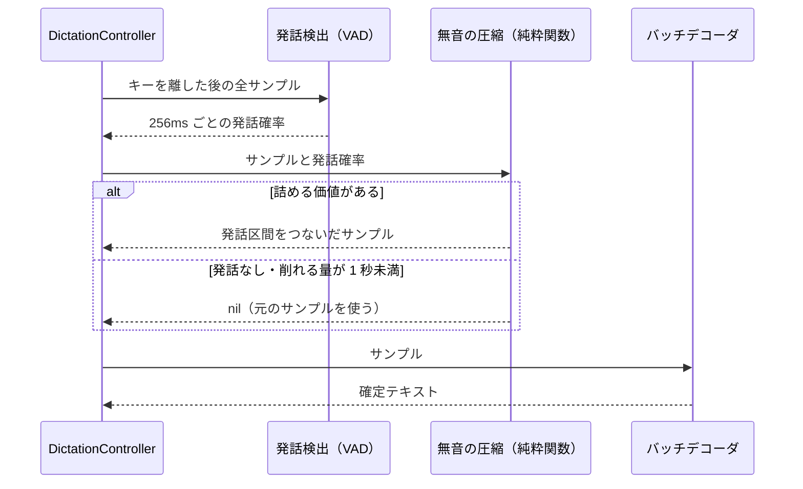

# 51. ディクテーションの二段目デコードで無音を飛ばす

キーを離した後のバッチデコード（design 31）に渡す音声から、長い無音を VAD で詰めてから渡す設計。

参照元: `docs/design/31-dictation-two-pass-decode.md`（キーを離した後のバッチデコード）,
`docs/design/45-qwen3-batch-decode.md`（Qwen3 の 30 秒窓）,
`docs/design/33-meeting-two-pass-decode.md` MT6 (a)（会議側の先頭無音の切り詰め）。

## 1. 現状と課題

キーを押している間の音声は全サンプルがそのままバッチデコーダに渡る。無音を削る処理は無い。

- バッチデコーダは音声を窓（Parakeet は 15 秒、Qwen3 は 30 秒）に切って順にデコードするので、
  かかる時間は音声の長さにほぼ比例する
- 考えながら話すと、話した中身は 10 秒でも、キーを押している時間は 60 秒になる。
  その差の 50 秒分のデコードを、キーを離した後にユーザーが待つ
- 無音を長く含む窓では、モデルが存在しない文を作る（ハルシネーション）おそれもある

## 2. 決定事項

| ID | 決定 |
|---|---|
| SS1 | バッチデコードの直前に、Silero VAD（FluidAudio の `VadManager`）で 256ms ごとの発話確率を出し、長い無音を詰めた音声をデコーダに渡す |
| SS2 | 詰める対象はバッチデコードに渡すサンプルだけ。一段目のストリーミング、履歴の `audio.wav`、`duration_ms` は変えない |
| SS3 | 発話確率 0.5 以上のフレームを発話とし、各発話区間の前後に 0.3 秒の余白を付ける。余白を付けた後の区間どうしの間が 0.8 秒未満なら1つにつなぐ |
| SS4 | 詰めた箇所には 0.3 秒の無音（ゼロ）を挟む。発話どうしが直につながって、語が連結されて読まれるのを防ぐ |
| SS5 | 先頭と末尾の無音も余白を残して削る |
| SS6 | 次のときは詰めずに元の音声を渡す（取りこぼしより待ち時間を譲る）。(1) VAD が発話を1フレームも見つけない（小声を取り逃した可能性がある）、(2) 削れる量が 1 秒未満、(3) VAD のロード・推論が失敗した |
| SS7 | `dictation.skip_silence`（既定 `true`）で切れる。設定画面の再認識モデルの下にトグルを置く。オフは従来どおり全サンプルを渡す |
| SS8 | VAD モデルはバッチデコーダの warm と同じ時点で読み込む（初回だけ FluidAudio が `~/Library/Application Support/FluidAudio/` にダウンロードする）。読み込み前にキーを離した発話は、読み込みの完了を待ってから詰める |
| SS9 | 詰める前後の秒数・VAD の所要時間・デコードの所要時間を info でログに出し、効果を測れるようにする |
| SS10 | 会議の書き起こしには入れない。会議の再デコードは非同期でユーザーを待たせず、窓の時間幅でタイムスタンプを按分している（design 33 MT3）ため、途中を詰めると按分の手直しが要る。dictation で効果を確かめてから広げる |

## 3. 構成

- 発話検出は `DictationSpeechDetecting` プロトコルの裏に置き、実装は `DictationVadSpeechDetector`
  （`VadManager` を1つだけ読み込んで使い回す actor）。`DictationController.shared` だけが実装を渡し、
  テストで組み立てるコントローラは `nil`（VAD を使わない）になる
- 圧縮は `DictationSilenceCompactor.compact` の純粋関数で、単体テストで区間の計算を確かめる

## 4. テスト

- `DictationSilenceCompactorTests`: 先頭・末尾・途中の無音を詰める、短い間はつなぐ、余白の付与と端での切り詰め、
  発話なし・削れる量が少ないときに `nil`、詰めた箇所に 0.3 秒の無音が入る
- `DictationControllerTwoPassTests`: 偽の発話検出を渡すと、バッチデコーダに詰めたサンプルが届く。
  `skip_silence` がオフ、または検出が失敗したときは元のサンプルが届く
- `DictationConfigTests`: `skip_silence` の既定値と読み書き
